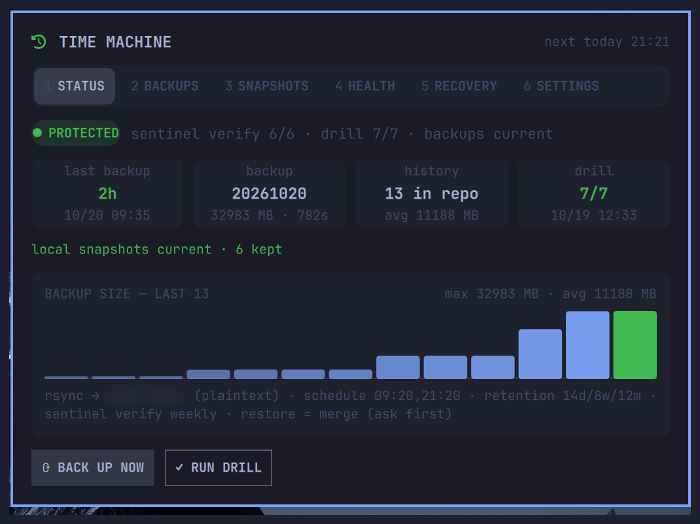
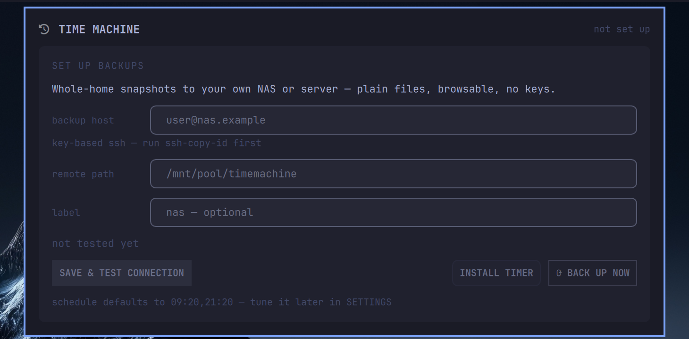
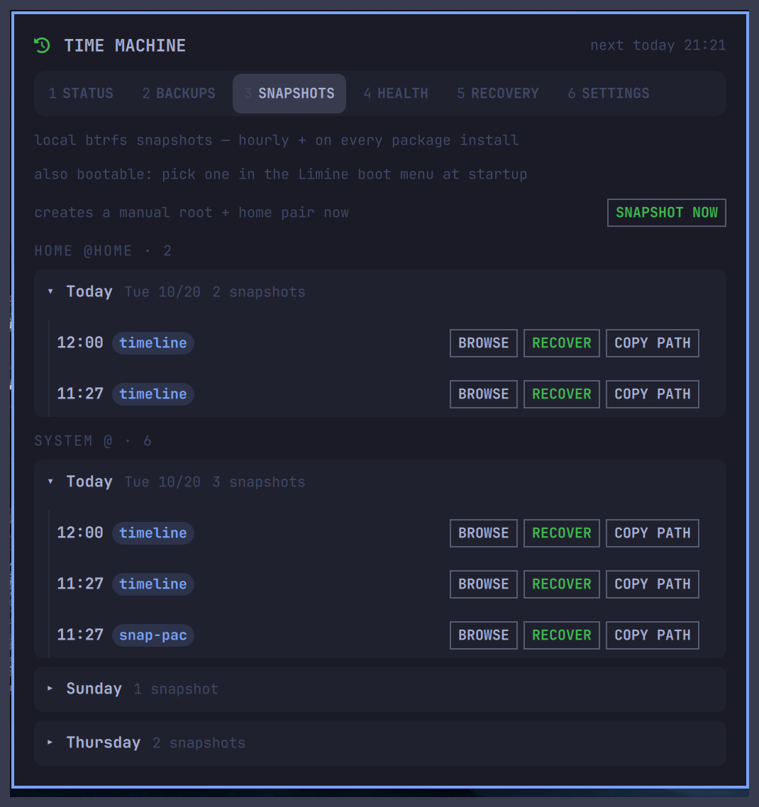

# TimeMachine — an Omarchy bar plugin

A glanceable backup chip for the Omarchy bar: status dot, last-backup age, and
a six-tab popup — **Status · Backups · Snapshots · Health · Recovery ·
Settings** — over a self-hosted, **unencrypted rsync time machine** on your
own NAS or server, plus local btrfs snapshots. Plain files, browsable, no
keys to lose.



## Why

Backups you can't inspect aren't backups. This plugin fronts a whole-home
backup scheme with no proprietary format and no encryption layer: each backup
is a full directory tree hardlinked against the previous one, so every backup
is browsable and any file is recoverable with `scp` — from any machine, with
zero tooling. The chip makes the state of that pipeline impossible to ignore,
and the popup keeps restore paths one click away.

## Install

```sh
omarchy plugin add https://github.com/gdeyoung/omarchy-timemachine --enable
```

Then click the chip. If no backup target is configured you land in
**first-run setup**: enter host, remote path and a label, **TEST CONNECTION**
(SSH, key-based), and once green, **INSTALL TIMER** — the plugin writes a
systemd user timer from your schedule and runs the first backup.



Prefer the terminal? `bin/tm-conf.sh init` writes a starter
`~/.config/timemachine.conf`, then `set` keys, `test`, and `install`.

## The tabs

| Tab | What you get |
|---|---|
| **1 STATUS** | verdict pill (PROTECTED / STALE / FAIL / RUNNING), stat cards, backup-size chart, local-snapshot freshness, Back up now / Run drill |
| **2 BACKUPS** | off-box rsync trees on your NAS — capacity (free/total), collapsible day picker (collapsed by default, today expanded), per-backup rows with browse/recover/copy-path |
| **3 SNAPSHOTS** | local btrfs snapshots (snapper) — SYSTEM and HOME sections, same day picker, type badges (timeline / pre / post / snap-pac / manual), browse/recover/copy-path, SNAPSHOT NOW |
| **4 HEALTH** | last drill, weekly sentinel verification, healthcheck result, config drift |
| **5 RECOVERY** | plaintext emergency card — sshfs browse, single-file fetch (from a backup or a local snapshot), full-restore commands, copyable |
| **6 SETTINGS** | target/schedule/retention/sentinels editing, connection test, timer install — all writes go through a validated bridge script |



## The engine (`bin/`)

The plugin bundles the whole pipeline — no external scripts required:

- `tm-backup.sh` — rsync `-aH --no-D --link-dest` backup (`--no-D` = `--no-specials --no-devices`: FIFOs, sockets and device nodes are never transferred, so no special file can ever land in a backup tree) + retention (14 daily / 8 weekly / 12 monthly, newest-of-day) + weekly sentinel sha256 verify. The transfer stages into a hidden unique dir that is renamed into place only on completion, and an existing snapshot destination is refused outright — a rerun can never write into a completed backup. Only a cleanly completed run advances `latest`, retention and the success stamp; a failed transfer discards its staging dir unpublished.
- `tm-restore.sh` — `--list / --latest / --backup <id> / --files '<glob>' / --drill`; restores **stage to a scratch dir, never write live state**
- `tm-backups.sh` — lists the remote backup tree for the BACKUPS tab (popup-open only)
- `tm-snapper.sh` — lists local snapper snapshots for the SNAPSHOTS tab (popup-open only, read-only)
- `tm-snapshots.sh` — one-release compat shim over `tm-backups.sh` (removed in v0.6)
- `tm-health.sh` — healthcheck + failure notification command
- `tm-conf.sh` — the only thing that ever writes `~/.config/timemachine.conf` (validated `get/set/json/test/install/uninstall --yes`)
- `tm-common.sh` — conf loader (env > conf > default)

Configuration lives in `~/.config/timemachine.conf` (chmod 600, created by
setup): host, SSH port, remote path, schedule, retention, sentinel files,
notify command. See `bin/timemachine.conf.example` for every key.

## Data contract

The bar reads only cheap local state — JSON stamps in the state dir
(`last-backup.json`, `history.jsonl`, `drill-last.json`, `verify-last.json`,
`health-last.json`) plus `systemctl --user` — emitted as one JSON line by
`tm-probe.sh`. The BACKUPS tab fetches the target only while the popup is
open; the SNAPSHOTS tab reads local snapper state only while open. Backup
ages come from the ID (`YYYYMMDD-HHMM`), never mtimes.

## Security & trust

| Property | How |
|---|---|
| No secrets in the plugin | Endpoints/credentials live only in your local conf (600). The repo carries zero hostnames, IPs or keys — enforced by test. |
| QML never writes files | Every write is an argv-array call to the validated bridge script. |
| Non-destructive UI | No delete, no overwrite, no pin. Restore stages to scratch; merging back is a deliberate act. Snapshot rollback stays a boot-menu/terminal action, never a popup button. Uninstall is CLI-only with `--yes`. |
| Timer install is 2-click | Arm, then confirm — five-second window. |
| Unencrypted by design | Your NAS, your files: recoverable with ssh/scp alone. Encryption is a property you can add at the filesystem layer (e.g. ZFS native) — not one the backup tool imposes. |
| Systemd-native | Units are plain user units you can inspect; `tm-conf.sh uninstall --yes` removes them without touching backups. |

### What the plugin runs

Every external command, so a reviewer can match code to explanation:

| Surface | Commands |
|---|---|
| `tm-backup.sh` | `rsync` over `ssh` (BatchMode, key auth); remote `mkdir`/`ln`/`readlink`/`rm` **only inside its own backup directory**; `sha256sum` sentinel verify |
| `tm-backups.sh`, `tm-restore.sh`, `tm-health.sh` | read-only `ssh` (`ls`/`readlink`/`du`/`df`); restore copies stage to scratch |
| `tm-conf.sh` | reads/writes its own `~/.config/timemachine.conf`; `systemctl --user` for its own timer units only |
| `tm-snapper.sh` | `snapper list-configs`, `snapper -c <config> list` — read-only, as your wheel user |
| Bar widget | `snapper -c root/home create -d manual` (SNAPSHOT NOW); `xdg-open <snapshot dir>` (BROWSE); clipboard via stdin-piped `wl-copy` (nothing private on argv); `systemctl --user` status reads |

No `sudo`, no package-manager calls, no network beyond your configured SSH
target.

## Automation surface

```
omarchy-shell gdeyoung.timemachine summon|toggle|refresh|tab 0-5|scroll N|status
```

## Dev

```sh
node --test tests/    # pins chip wiring, probe JSON contract, repo hygiene
```

Chart idiom adapted from `gdeyoung.sysmon` (HistBars, MIT).

## Uninstall

```sh
~/.config/omarchy/plugins/gdeyoung.timemachine/bin/tm-conf.sh uninstall --yes
omarchy plugin remove gdeyoung.timemachine --yes
```

Backups on your backup host are never touched.

## License

MIT — see [LICENSE](LICENSE).
